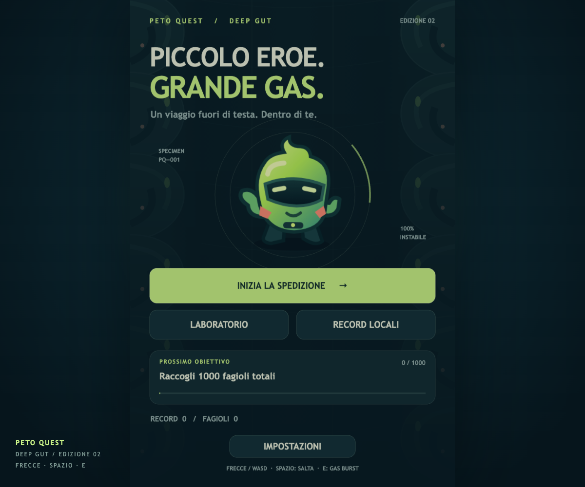
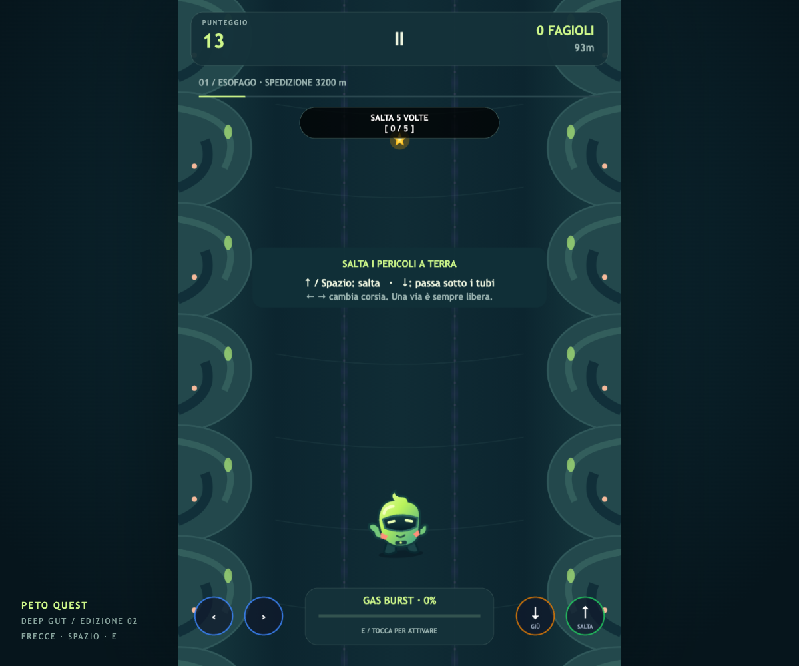

<div align="center">


# PETO QUEST · DEEP GUT

### Piccolo eroe. Grande gas.

Un runner arcade dentro di te. Letteralmente.<br />
Schiva, salta, raccogli fagioli. Le conseguenze sono tutte tue.


[Dentro il gioco](#-una-spedizione-poco-digeribile) · [Gioca in locale](#-pronti-partenza-gas) · [Comandi](#-pollici-pronti) · [Note di rilascio](RELEASE-NOTES.md)

</div>

---

## 🧪 Una spedizione poco digeribile

Sei una minuscola creatura con un visore, una scorta di fagioli e un discutibile piano di fuga. Davanti a te: quattro regioni organiche, cristalli appuntiti, pozze acide e tubi sotto cui passare al volo.

**Deep Gut** porta Peto Quest in un mondo verde acido, petrolio e corallo, con asset vettoriali originali, una spedizione da completare e un'abilità da tenere pronta per i momenti peggiori.

<table>
  <tr>
    <td width="50%"></td>
    <td width="50%"></td>
  </tr>
  <tr>
    <td align="center"><b>Faccia innocente. Intenzioni esplosive.</b></td>
    <td align="center"><b>La digestione non aspetta nessuno.</b></td>
  </tr>
</table>

### Scegli come lasciare il segno

| | Cosa ti aspetta |
| :--- | :--- |
| 🧭 **Spedizione** | Quattro regioni, **3.200 metri** e **2.500 punti bonus** se arrivi in fondo. |
| ♾️ **Corsa infinita** | Nessun traguardo. Solo tu, la velocità crescente e quel record da battere. |
| 💨 **Gas Burst** | Carica l'energia, scegli il momento e attraversa gli ostacoli per **3 secondi**. |
| 🧬 **Laboratorio** | Tre look e due potenziamenti permanenti, acquistabili con i fagioli raccolti. |
| 🎯 **Missioni e combo** | Obiettivi durante la corsa, moltiplicatori e schivate perfette per chi ama rischiare. |

Ogni fila di ostacoli lascia almeno una corsia libera. Trovarla in tempo è la parte divertente.

## 🌶️ Sei quello che mangi

La preparazione conta. Anche quando è una pessima idea.

| Ricetta | Effetto | Filosofia |
| :--- | :--- | :--- |
| **Fagioli magici** | +15% di velocità iniziale | «Frenare è sopravvalutato.» |
| **Cipolla orbitale** | Raggio maggiore quando il magnete è attivo | «Attiro cose. Allontano persone.» |
| **Peperoncino infernale** | Fagioli e punti raccolti valgono il doppio | «Nessun rimpianto. Per ora.» |

> **Il momento giusto per mollare un Gas Burst?** Ogni fagiolo aggiunge 8 di energia, una schivata perfetta ne aggiunge 20. Arriva a 100 e premi **E**, oppure tocca la barra. Durante il Burst non accumuli altra carica: usalo bene.

## 🎮 Pollici pronti

| Azione | Tastiera | Touch |
| :--- | :--- | :--- |
| Cambia corsia | `←` `→` oppure `A` `D` | Swipe laterale o pulsanti |
| Salta | `↑`, `W` o `Spazio` | Swipe verso l'alto o pulsante ↑ |
| Scivola | `↓` o `S` | Swipe verso il basso o pulsante ↓ |
| Gas Burst | `E` | Tocca la barra carica |
| Pausa | `Esc` | Tocca Ⅱ |

**Cristalli e pozze? Salta. Tubi? Scivola. Panico? Respira.** La pausa congela anche bonus e timer; il gioco si mette in pausa quando nascondi la pagina.

## 🚀 Pronti, partenza, gas

Serve **Node.js 22 o successivo**, con npm.

```sh
git clone https://github.com/Pnda90/Peto_quest_v1.0.git
cd Peto_quest_v1.0
npm ci
npm run dev
```

Apri l'indirizzo mostrato nel terminale. Su macOS puoi anche usare **[Avvia gioco.command](Avvia%20gioco.command)** dalla cartella del progetto.

### Preparare la build

```sh
npm run build
npm run preview
```

Il gioco distribuibile finisce in **`dist/`**. Servilo tramite HTTP: aprire `index.html` con doppio clic non avvia correttamente il gioco.

## 🛠️ Sotto il visore

**Phaser 3 + TypeScript + Vite**, con audio sintetizzato tramite Web Audio API. Gli SVG sono modificabili, il font è di sistema e il gioco non carica font o librerie da CDN esterni.

```text
src/game/scenes/     Le schermate e la corsa
src/game/systems/    Input, audio, salvataggi, missioni e Gas Burst
src/game/ui/         Il tema visivo condiviso
public/art/         Protagonista, ambienti e ostacoli SVG
tools/qa/           Verifiche automatiche nel browser
```

I progressi rimangono **nel browser che usi**: record locali, look e potenziamenti. Non c'è una classifica online o un salvataggio cloud. Questa edizione usa la chiave `peto_quest_deep_gut_v2`, separata da quella del gioco originale.

<details>
<summary><b>🧰 Banco di prova — test e verifiche</b></summary>

<br />

```sh
npm test
npm run lint
npm run build
```

Per lo smoke test del browser, avvia il server:

```sh
npm run dev -- --host 127.0.0.1 --port 5188
```

Poi, in un secondo terminale:

```sh
node tools/qa/browser-smoke.mjs
```

Lo script usa Chrome locale su macOS. Per altri percorsi imposta `CHROME_PATH`; per un server diverso imposta `QA_URL`. Le schermate finiscono in `qa/`, esclusa da Git. L'accesso di test allo stato del gioco è disponibile soltanto in sviluppo.

Le verifiche coprono pausa, controlli, Burst, riavvii, ambienti e fine spedizione. L'emulazione touch in Chrome non sostituisce le prove su telefoni reali.

</details>

## 🗺️ La prossima fermata

Questa edizione è giocabile e include la build per hosting statico. Prima del rilascio commerciale restano il playtest del bilanciamento, le prove su Safari/iPhone e Android reali e l'integrazione di un eventuale accesso a pagamento. Checkout e account non sono implementati.

- [Note di rilascio](RELEASE-NOTES.md) — novità, limiti e pubblicazione.
- [Registro degli asset](ASSETS.md) — cosa è nuovo e cosa arriva dal gioco originale.
- [Licenza MIT](LICENSE) — codice e condizioni di utilizzo del progetto.

---

<div align="center">

Creato da **[Gianluca Bernardo · Pnda90](https://github.com/Pnda90)**

**Un altro tentativo. Poi basta.**<br />
<sub>La bugia più antica della storia degli arcade.</sub>

</div>
